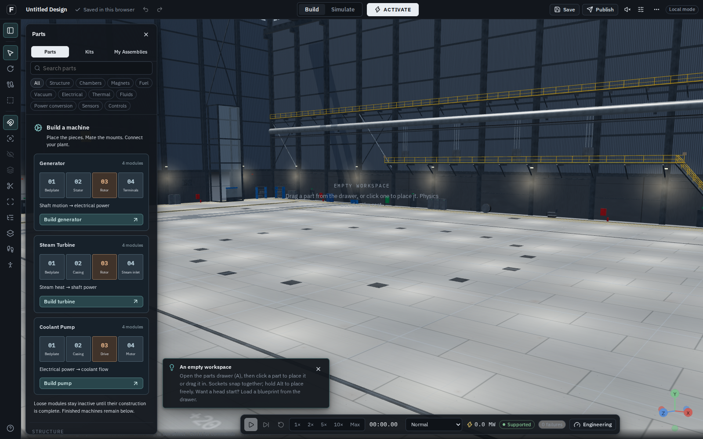
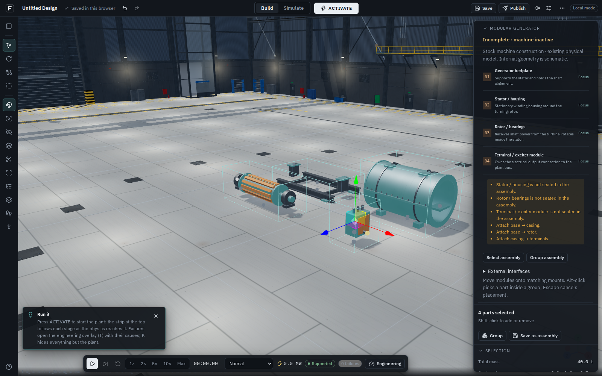
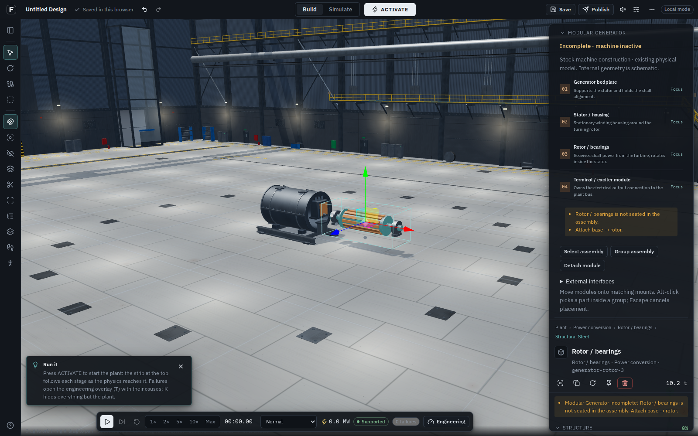
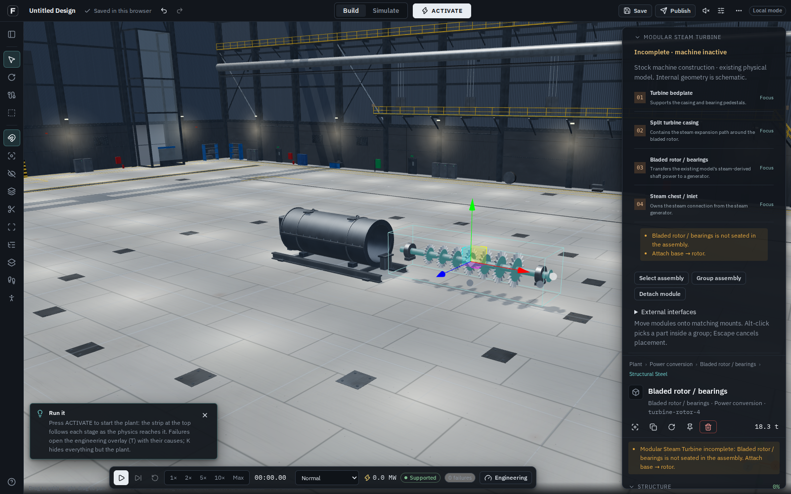

# Build machines from meaningful modules

The previous visual pass changed surfaces and light while leaving construction largely
pump-only. This change extends the actual stock construction capability from one machine
family to three: pump, generator and steam turbine. It continues the existing editor and
construction metadata rather than introducing a second builder or physics engine.

## Visible and playable changes

The Parts drawer now opens with **Build a machine** cards. Each card explains the energy
conversion and shows its four modules. **Build generator** and **Build turbine** place
loose, independently editable pieces. Finished machines remain available below the cards;
the existing Kits and My Assemblies tabs remain available.

| Machine       | New independently placeable modules                                                                 | External interfaces                                                               |
| ------------- | --------------------------------------------------------------------------------------------------- | --------------------------------------------------------------------------------- |
| Generator     | Bedplate with bearing pedestals; hollow stator/housing; rotor and bearings; terminal/exciter module | Structural base on bedplate; shaft on rotor; electrical output on terminal module |
| Steam turbine | Bedplate with bearing pedestals; split casing; bladed rotor and bearings; steam chest/inlet         | Structural base on bedplate; steam on chest; shaft on rotor                       |

These are **eight new catalogue parts and two new construction kits**. The generator
rotor has a distinct winding-pack representation; the turbine rotor has seven visible
bladed stages. Housings have open axial bores, casing seams, flanges, access covers, lifting
eyes and mounting feet. Loose modules and finished legacy machines share one geometry source.
Repeated details are batched into up to three static material buffers per module. A module
rotor's main/accent geometry rotates while its bearing trim stays stationary.

The construction inspector explains each module, focuses it in the scene, distinguishes
missing/separated joints from complete construction, and retains select/group/detach and
external-interface controls. Detach moves a long module clear of the other assembly member
envelopes, instead of using the pump's fixed 2.5 m offset. Undo restores the original joints
and transforms. This endpoint clearance does not claim a swept collision/pathfinding solver.

## Physical meaning and limits

- Only supported stock parts, dimensions, materials, seated transforms and actual keyed
  mount joints can complete a machine. Grouping or visual overlap does not complete it.
- Rotor bearing pedestals have upward load-bearing seats. Lateral alignment alone does
  not support weight in the existing structural model; no gravity or support rule was
  weakened to make the demo operate.
- Completion resolves inside sim-core to one existing generator or turbine model. Existing
  conversion parameters/equations are retained. Modules remain passive when incomplete,
  unsupported or assigned a forged active role. No independent winding, blade-stage,
  shaft-dynamics, RPM or efficiency-design solver is claimed.
- Each external connection belongs to its actual module. Condensation remaps those endpoints
  for the plant solve. Structural mass is counted once. The existing lumped thermal model
  distributes heat rates by module mass; manufactured internal geometry is schematic.
- Per-machine shaft/electrical outputs are published through two appended worker-frame
  fields. Rotor activity follows its own output and disabled state, not another generator's
  gross power. The animation speed is illustrative, not measured RPM.
- Existing project/selection assembly serialization stores the same authored membership.
  Saved completion claims remain untrusted. Old finished machines and pump kits retain
  their existing definitions and loading paths.
- Construction modules appear under their machine's plant system, while their authored
  physics role remains passive structure until the core resolves a complete construction.

This is the next functional construction milestone, **not the complete modular reactor or
facility**. Interchangeable performance-bearing internals, coil/vessel construction, a
multihall campus, full mesh collision and swept extraction remain future capabilities.
These stock recipes do not imply that arbitrary rotor/stator substitutions are supported.

## Verification

Results: **723 tests in 81 files passed**, along with TypeScript, ESLint and the production
build. The production pump regression suite also passed ghost/snap placement, Alt picking,
transforms, detach/undo, saving/reuse, real coolant flow, coupling animation and exact reset.
Two repeated resource cycles returned to the same geometry baseline, disposing all 52
tracked geometry resources each time. The new powertrain browser suite passed both machine
families, reference-plant operation and reset with no browser/graphics errors.

`pnpm verify` covers TypeScript, ESLint, unit/integration tests and production build.
Focused tests cover completion, unseated/unsupported parts, cross-family rejection,
single-count mass, owned ports, auto-discovery from mount graphs, project saves, independent
copies, long-rotor detach/undo, actual open casing bores and a 30,000-triangle ceiling per
module. The operating reference-plant comparison replaces both legacy machines with stock
constructions and checks equal gross conversion power; the whole reference plant is still
a net electricity consumer under that scenario.

The production-browser suite `e2e/powertrain.mjs` uses actual editor controls and the same
public transform action as the gizmo. It checks the workshop entry, loose inactive kits,
keyed snapping, the inspector's focus/detach controls, undo, draft reload, independent
saved-assembly copies, operation in the reference plant, output-driven rotors and exact
Stop design reset. Its operating fixture is explicitly a test fixture, not a preassembled
plant inserted into a new player's hall. See [the browser evidence](powertrain-construction/evidence.json).

```bash
pnpm verify
pnpm format:check
pnpm vercel-build
node scripts/serve-output.mjs 3000
# In the same environment/network session:
PLAYWRIGHT_CHROMIUM_EXECUTABLE_PATH=/path/to/chromium \
  E2E_SHOTS=/tmp/powertrain node e2e/powertrain.mjs http://localhost:3000
```

Software Chromium captures do not prove hardware GPU frame rates or Chromebook performance.
Hosted accounts, cloud saves, team/voice acceptance require configured Supabase/LiveKit;
they are not established by local browser success. Existing large build chunks remain.
No new dependency, external art, model download, schema migration or public deployment is
included in this change.

## Actual editor captures








