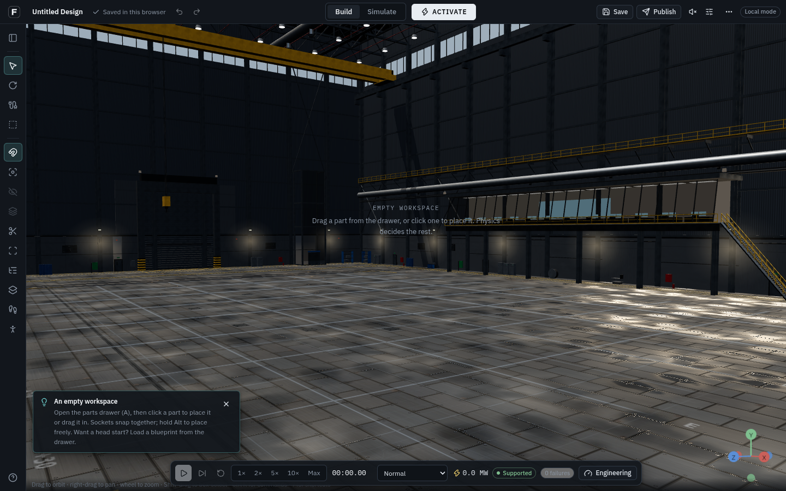
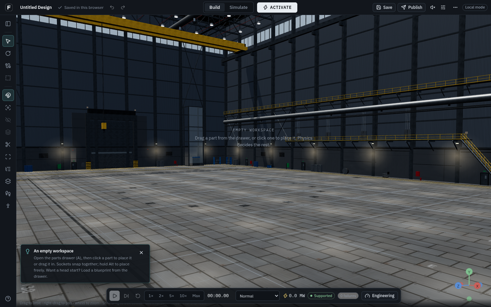
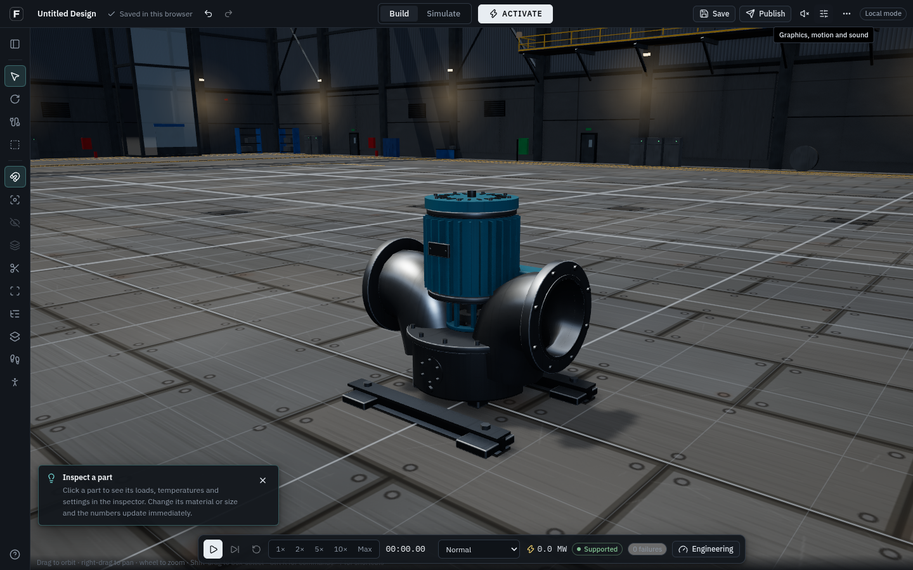
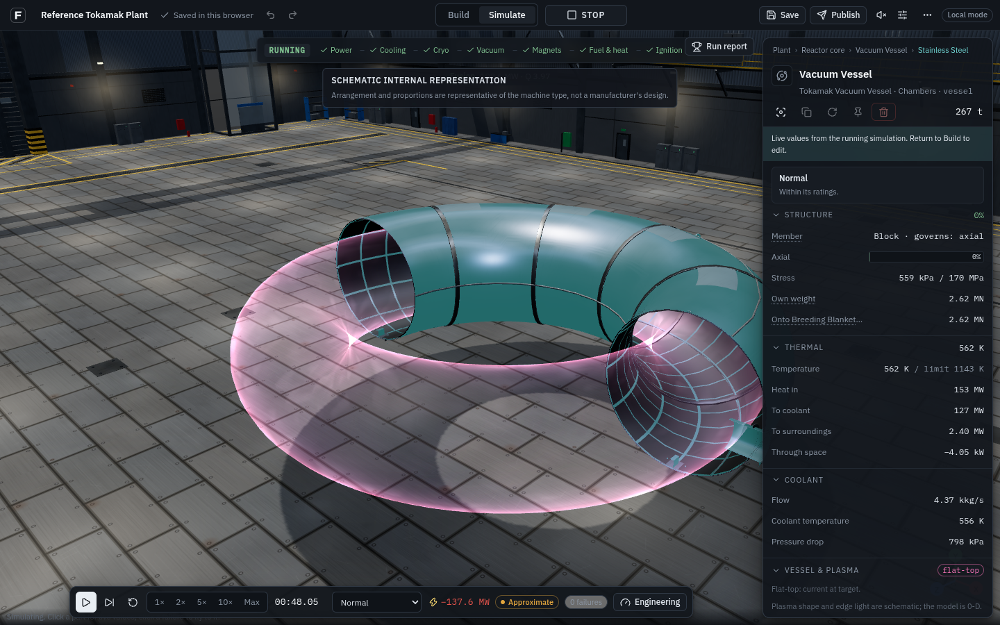
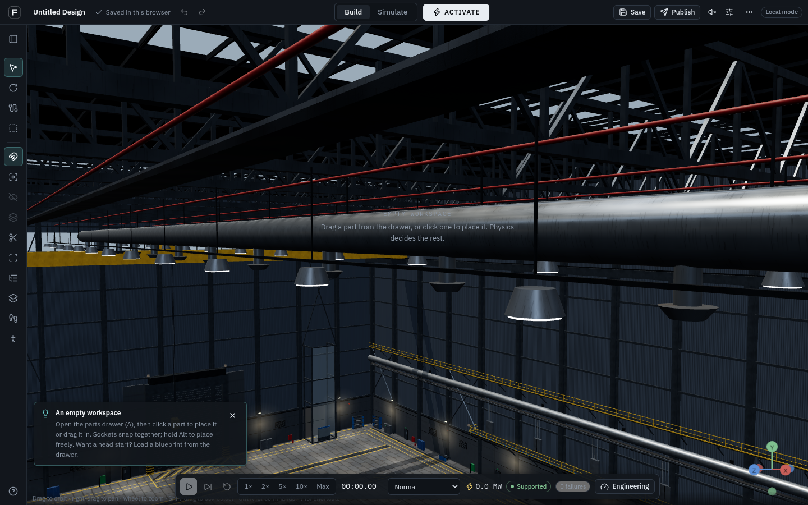

# ForgeLab visual realism: implementation and production plan

The target is an open, believable industrial assembly warehouse with a dry working floor,
useful equipment at its perimeter and engineering machines that look manufactured. The
user-supplied warehouse and ITER illustrations are visual references, not shipped textures
or evidence that ForgeLab already matches their detail.

This milestone improves the shared rendering foundation, plasma, internal substance cues,
warehouse and particle effects. It does **not** finish photorealism for the whole catalogue.
Simulation, construction, port compatibility, saving and multiplayer authority are unchanged.

## What changed in this milestone

| Area                 | Previous issue                                                                                                                    | Implemented                                                                                                                                                                                     |
| -------------------- | --------------------------------------------------------------------------------------------------------------------------------- | ----------------------------------------------------------------------------------------------------------------------------------------------------------------------------------------------- |
| Machine materials    | Bare metal and paint had similar reflectance; a mid-grey roughness map effectively halved roughness, including on matte materials | Near-neutral wear multiplier; distinct bare-metal and dielectric finishes; brighter machined trim; nonmetallic painted accents                                                                  |
| Internal materials   | Most solid regions shared one generic finish                                                                                      | Solid regions use their own material family; copper, steel, ceramics and insulation remain distinct under thermal colouring                                                                     |
| Internal fluids      | Blue transparent volumes made different substances resemble the same liquid                                                       | Subtle neutral water cue, amber oil, opaque metallic lead–lithium; ordinary helium/hydrogen fuel gases invisible in Normal; diagnostic overlays retain their colours                            |
| Plasma               | Strong uniform neon skin, overbright highlights; invalid density could still glow                                                 | More transparent face, bounded edge emission, sparse drifting filaments; density falls continuously to darkness; invalid/missing density gives no glow; reset/disruption clears breakdown flash |
| Scientific clarity   | Comment claimed a hot core cannot emit visible light at all                                                                       | Corrected to weak visible continuum versus cooler-edge line emission; inspector labels shape and light as schematic                                                                             |
| Warehouse floor      | Decorative oil slicks and standing-water roughness patches                                                                        | Dry satin deck with seams, fixings, subtle traffic wear and seam dust; reduced high-tier reflection strength                                                                                    |
| Warehouse layout     | Enclosed control rooms projected inside the hall                                                                                  | Open braced maintenance gantry, open service catwalks and exposed wall services; perimeter equipment retained                                                                                   |
| Roof and light       | Reflection probe suggested roof-light strips absent from the roof                                                                 | Two framed roof-light strips, matching broad probe highlights; clearer wall lighting; removed fictitious control-room glow from reflections                                                     |
| Smoke, mist and dust | Static texture patterns rotating as round sprites                                                                                 | Advected density detail gives changing wisps while retaining bounded particle pools                                                                                                             |
| Fire                 | Soft round additive blobs                                                                                                         | Tapered, moving flame tongues with hotter cores; existing combustible/ignition event gates retained                                                                                             |
| Electrical sparks    | Similar hard-particle shading to water spray                                                                                      | Bright hot streaks; separate nonemissive droplet rim/glint shading; tone/output conversion supports direct and postprocessed rendering                                                          |

All assets in this pass are repository-authored procedural geometry, textures or shaders.
There is no new dependency, paid model export, required download or new physics solver.

## Plasma: what a believable view can and cannot show

Fusion plasma is ionized gas, not liquid metal or a solid glowing object. At fusion
temperatures the core is highly ionized. It emits continuum radiation, including a weak
visible component; saying it emits _no_ visible light is too strong. Cooler edge regions,
neutral fuel and impurities can produce strong spectral lines. A camera's colour depends on
its wavelength response, filters, exposure, optical path and the species present.

Hydrogen's familiar Balmer lines are approximately 656 nm (red), 486 nm (blue-green) and
434 nm (violet); isotope shifts mean deuterium wavelengths differ slightly. These motivate
an edge palette, not a uniquely correct pink colour for every reactor. Plasma colour does
not act as a direct thermometer. White saturation is a camera/exposure effect, not proof
of a white-hot liquid core. Magnetic fields themselves are invisible.

The implemented shader uses a bounded grazing-angle term to suggest a longer optical path
through the edge. Sparse periodic noise follows an integer approximation of pitch from
published q95. Its UV pattern closes around the torus. The interior remains visible through
a faint face. Density and active phase gate brightness; no positive finite density means
no light. A breakdown flash is allowed only with active plasma and is cleared on reset.

**Limits:** ForgeLab's plasma model is 0-D: one bulk temperature/density, not a spatial
emissivity, MHD, spectroscopy or radiative-transfer calculation. The circular/linear volume,
edge thickness, filaments, drift speed and exposure are schematic. Density alone does not
determine line emission: neutral fraction, electron temperature, impurities and optical
response also matter. Do not interpret these pixels as a measured distribution or a
prediction of what a real ITER camera would record. A future D-shaped boundary requires
supported vessel/plasma geometry; changing only the drawing would misrepresent the model.

## Complete visual-system plan

“Implemented” below refers to this milestone or explicitly named existing functionality.
“Next” identifies work still required; it is not a completion claim.

| System                                   | Visual treatment and physical source                                                                                         | Status / next useful improvement                                                                                                                                                    |
| ---------------------------------------- | ---------------------------------------------------------------------------------------------------------------------------- | ----------------------------------------------------------------------------------------------------------------------------------------------------------------------------------- |
| Stainless steel                          | Neutral conductor reflectance, controlled roughness, fine brushing and long light reflections; dimensional seams and flanges | Shared finish improved. Next: authored grain direction and local weld/heat-affected zones on important machines                                                                     |
| Structural steel                         | Darker rough metal; manufactured sections, gussets and load paths rather than arbitrary cubes                                | Finish and hall steel improved. Next: selective edge bevels and restrained corrosion at exposed fixings                                                                             |
| Machined shafts / fasteners              | Brighter, smoother metal distinct from the casing; consistent bolt sizes and axes                                            | Trim improved; existing merged fasteners preserved. Next: distance-based detail, never a mesh per bolt                                                                              |
| Painted machinery                        | Dielectric paint over metal; satin broad highlights, consistent product colours                                              | Nonmetallic coating implemented. Next: authored chips exposing a second substrate, not metallic paint everywhere                                                                    |
| Copper / conductors                      | Warm conductor colour, metallic reflections; darkening from published temperature response                                   | Shared/internal finishes improved; thermal response retained. Next: routed winding packs and insulation layers with correct interfaces                                              |
| Aluminium / titanium / refractory metals | Distinct library colours and roughness; material-specific heat response                                                      | Shared finish improved. Avoid making aluminium turn red before it has softened; do not ignite bulk tungsten as fuel                                                                 |
| Rubber / polymer / ceramic / graphite    | Dielectric, generally rougher than machined metal; restrained normals                                                        | Shared roughness defect fixed. Next: surface-specific microtexture and seals, ceramic edge detail, fabric/insulation patterns                                                       |
| Concrete / masonry                       | Dielectric, rough diffuse surface, metre-scale joints and subtle pores; cracks only from supported damage                    | Existing rough concrete retained; shared matte-finish defect fixed. Next: better local wear and junction detail without a universal metallic shader                                 |
| Glass / sight ports                      | Dielectric reflections; supported optical thickness, refraction and absorption when available                                | Hall glass no longer uses metallic reflectance. Current alpha glass is approximate; true transmission/refraction in sight glasses is future work                                    |
| Hot solids                               | Temperature-derived oxide/char/incandescence; no decorative heat emission on cold material                                   | Existing `appearance.ts` retained. Next: region-specific temperatures only when sim-core publishes them                                                                             |
| Water / coolant                          | Clear-to-faint neutral volume; bounded specular droplets from an actual leak                                                 | Internal cue and spray shader improved. Next: refraction/absorption in supported sight glasses; fill surface only with a supported fill-level model                                 |
| Liquid metal / oil                       | Opaque metallic lead–lithium; amber dielectric oil; no universal blue liquid                                                 | Schematic internal cues implemented. Oxidation, meniscus and phase-dependent surfaces remain future work                                                                            |
| Steam                                    | Water vapour is invisible; white visible plume is condensed droplets                                                         | Existing pressure/blowdown recipes retained; animated mist texture improved. No CFD, humidity or condensation solver is claimed                                                     |
| Cryogenic releases                       | Visible mist comes from condensed ambient moisture; helium gas is not white liquid                                           | Mist shading/comment corrected; existing boil-off-driven vent retained. Cold-plume motion is a presentation approximation, not a gas-density solver                                 |
| Plasma                                   | Optically thin edge cues driven by published phase/density; q95-inspired schematic pitch                                     | Improved in this pass. Spectral/exposure controls and measured emissivity require additional data                                                                                   |
| Magnetic fields                          | Optional labelled diagnostic lines; actual field quantities where computed                                                   | Existing field overlay retained. Never render fields as solid hardware or invent field cables                                                                                       |
| Electricity                              | Closed intact conductors do not constantly glow or throw lightning; indicators show actual equipment state                   | Existing state-driven lamps retained. Sparks improved. Next: screen-readable arc core/halo with explicit approximate endpoint context; no calculated dielectric-breakdown paths yet |
| Fire                                     | Fuel plus ignition, buoyant intermittent flame, soot for the burning material; oxygen assumptions disclosed                  | Flame shader improved; event eligibility unchanged. No oxygen, combustion chemistry or smoke transport solver added                                                                 |
| Smoke                                    | Occluding grey/sooty wisps, not additive luminous fog; changing density and slower rolling motion                            | Noise advection and output handling improved. Next: soft depth intersections, improved sorting and light-aware volume approximation                                                 |
| Radiation / neutrons                     | Invisible in ordinary viewing; use labelled computed diagnostic quantities                                                   | Existing diagnostic overlays retained. No glowing radiation fog, neutron cables or invented particle paths are added                                                                |
| Pressure bursts                          | Directional release, decompression, fragments only when structural state supports fracture                                   | Existing family-specific recipes retained; spray/mist rendering improved. Avoid a universal spherical fireball                                                                      |
| Fusion disruption                        | Confined plasma terminates; wall energy deposition, dust/flash and damage only when published                                | Existing event recipe retained; plasma extinction fixed. Fusion does not behave like a nuclear bomb                                                                                 |
| Quench                                   | Resistive heating, relief vent and boil-off; fire only if another combustible source actually ignites                        | Existing noncombustion recipe retained, mist improved                                                                                                                               |
| Structural failure                       | Real failed pose plus supported debris, cracks and dust; machinery does not dissolve into unrelated particles                | Existing rigid/simple debris retained. Next: supported break geometry, material fracture detail and service routes following moving failed bodies                                   |
| Damage marks                             | Scorch at electrical faults; soot for combustibles; frost at cryogenic releases; tears/cracks for relevant breaks            | Existing bounded mark system retained. Next: surface-oriented detail and better transitions, no random damage on undamaged parts                                                    |
| Floor                                    | Dry manufactured deck, actual metre-scale seams, floor contact, restrained reflection                                        | Improved. No decorative puddles; a future spill needs a real release/accumulation model before it affects gameplay                                                                  |
| Warehouse                                | Open central area, wall storage and safety stations, crane, stairs, rails, ducts, service gantries and roof light            | Improved; no preassembled plant or new enclosed room. Fixture geometry remains presentation, not a complete collision/navigation model                                              |
| Lighting                                 | Cool roof/clerestory light plus warmer high-bay/work lights; readable silhouettes and contact shadows                        | Improved shared probe and hall visibility. Probe is an approximation, not real-time global illumination or a calibrated lux model                                                   |
| Shadows / reflections                    | Existing shadow tiers, generated PMREM, optional high-tier GTAO and blurred floor reflection                                 | Retained with subdued floor. Next: validate biases/contact at centimetres and large plant scale on hardware GPUs                                                                    |
| Haze / bloom                             | Restrained, optional; bloom only at luminous highlights; no haze hiding bad geometry                                         | Existing settings retained. Dense smoke is a local effect, not a reason to flood the empty hall with fog                                                                            |
| Cameras / interiors                      | Existing orbit/walk/fly, focus, clipping and layer inspection; no avatar required                                            | Preserved. Orbit currently restricts looking above its target; use walk/fly for upward inspection. Better navigation and mesh collision need a separate milestone                   |
| Presence / work orders                   | Lightweight orbs and contextual labels remain readable without resembling engineering radiation                              | Existing collaboration preserved; no fake teammates, voice or hosted-service availability claimed                                                                                   |
| Sound / replay                           | Audio and replay follow the same state/events as visuals                                                                     | Existing infrastructure retained; verify any new timing against event time, not a decorative animation trigger                                                                      |

Existing shock rings, camera flash and screen cracks are illustrative feedback, not measured
pressure-wave optics or a human-injury model. A later realism pass should replace conspicuous
luminous rings with supported dust/debris/condensation cues, preserving reduced-effects controls.
Particle flame colour is not a fuel-specific combustion spectrum. Warehouse glazing is not yet
physically refractive glass. These limitations remain visible work, not completed research.

## Machine-by-machine production order

Global finishes apply to existing rendered components, but do not add missing manufacturing
geometry to every model. Keep the catalogue and sim-core as the authority.

| Family                                     | Keep / improve next                                                                                                                                                                              |
| ------------------------------------------ | ------------------------------------------------------------------------------------------------------------------------------------------------------------------------------------------------ |
| Coolant pump                               | Existing detailed casing, fins, coupling guard, skid, fittings and ports; inspect the new steel/paint contrast at human scale, then add selective edge finishing                                 |
| Reactor chamber                            | Existing hollow shells, armour, end flanges and service bores; improve weld grain, vessel-specific section finishing and clearer interface labelling                                             |
| Magnetic coil / solenoid                   | Use the actual winding type and envelope; upgrade casing seams, supported winding pack, ribbing and cryogenic interfaces without fake field hardware                                             |
| Generator                                  | Prioritize casing proportions, stator ventilation, bearings, shaft, terminal enclosure and separate rotating surfaces; improve detail before adding polygon density                              |
| Steam turbine                              | Casing split line, bearings, supported shaft animation, inlet/exhaust and maintenance fasteners; preserve mechanical-state authority                                                             |
| Steam generator / heat exchanger           | Pressure shell, insulation seams, saddles, nozzles and access covers; avoid unmodelled glowing hot water inside an opaque vessel                                                                 |
| Cryopumps / vacuum equipment               | Distinguish compression stages, cold heads, service joints and pump-specific housings; mist only for supported releases                                                                          |
| Fuel / beam / RF equipment                 | Recognizable source and service construction; emission only where the core supports it; no magic visible beam through arbitrary closed metal                                                     |
| Blankets / shielding / electrical cabinets | Layered material sections and manufactured panels; inspection labels disclose schematic dimensions and bulk readings                                                                             |
| Pipes / cables / structural kits           | Existing obstacle-aware service routes and modular pump kit remain. Next: dimensioned elbows/reducers, trays/supports and routed-body motion; do not silently change compatibility or resistance |

## Three-dimensional construction and the world

ForgeLab already checks supported service-route geometry against occupied component proxies,
floor clearance, tube thickness and crossings. It supports physical pump-kit mates, undo and
incomplete-assembly warnings. See [PHYSICAL_REALISM_AUDIT.md](PHYSICAL_REALISM_AUDIT.md) and
[MODULAR_PUMP.md](MODULAR_PUMP.md).

That is not full CAD interference or a complete warehouse collision system. Detailed rendered
meshes are not authoritative collision geometry, and arbitrary part overlap/placement is not
fully resolved. Warehouse stairs, props and roof are presentation. A future collision milestone
must establish supported collision proxies, spatial indexing, placement diagnostics, floor/wall
constraints and tests at multiple scales. It must preserve permissive experimentation with
bad-but-simulatable engineering and avoid adding physical rules in React.

## Performance and resource policy

- Preserve fixed pooled arrays and one Points draw call per particle kind; this pass adds
  shader work, not unbounded emitters, particles or textures. Hardware profiling is still needed.
- Shared casing maps remain one 512² albedo/roughness/normal set, cached for the page lifetime.
  The procedural floor uses 1024² maps; the generated environment probe remains 256 pixels.
  No 4K/8K asset download or extra dependency is introduced.
- Hall geometry remains merged per zone/surface; fixtures are instanced. Removing enclosed
  rooms reduces geometry; adding roof frames stays in existing material batches.
- LOW/MEDIUM use image-based floor reflections; HIGH/ULTRA add blurred planar reflection and
  GTAO. All tiers use the same simulation. Reduced motion/flashes remain viewer settings.
- Shader particles are still an approximation: no fluid volumes, per-particle scene shadowing,
  order-independent transparency or depth-softened intersections. These are follow-up targets.
- Existing large production chunks remain a loading concern. Measure cold load and a large
  assembly on a Chromebook and a hardware GPU; software Chromium screenshots are not FPS proof.

## Research and evidence boundaries

The attached dossier is design input. Its generic GPU-fluid suggestions, “solid magnetic
field” language, blue-white-core description and broken citation markers are not validated
implementation requirements. Existing code and sources were inspected before changing visuals.

Sources available and read in this checkout:

- `packages/materials/src/library.ts`, `fluids.ts`, `sources.ts`: material-specific thermal
  response, combustion flags, IAPWS water properties, NIST helium references and liquid-metal
  source records. This pass does not revalidate the underlying papers or change their values.
- `packages/sim-core/src/plant/plasma.ts`: explicitly 0-D plasma equations and IPB98(y,2)
  reference (ITER Physics Expert Groups, Nuclear Fusion 39, 1999, 2175).
- `apps/web/src/presentation/vfx/recipes.ts` and tests: existing separation of electrical,
  coolant, cryogenic, structural, quench and disruption events and combustion eligibility.
- Installed Three.js shader chunks: tone mapping, output colour conversion and blending
  behaviour checked against the renderer used by this repository.

Primary-source web pages requested for this pass returned **proxy 403 / tunnel blocked**:
[ITER plasma](https://www.iter.org/fusion-energy/what-is-plasma),
[ITER fusion](https://www.iter.org/fusion-energy/what-is-fusion),
[NIST hydrogen lines](https://physics.nist.gov/PhysRefData/Handbook/Tables/hydrogentable2.htm),
[Khronos glTF PBR](https://registry.khronos.org/glTF/specs/2.0/glTF-2.0.html) and
[Blender Principled BSDF](https://docs.blender.org/manual/en/latest/render/shader_nodes/shader/principled.html).
These links are follow-up references, **not pages verified live in this session**. Precise
spectral calibration and measured optical constants remain unverified. A network-only
environment configuration draft adds `www.iter.org`, `physics.nist.gov`,
`registry.khronos.org`, `docs.blender.org`; it requires review/publishing in environment settings
and has not changed the running network policy. No substitute proxy was used.

## Asset and licence record

| Item                                                | Source / use                                                                                          |
| --------------------------------------------------- | ----------------------------------------------------------------------------------------------------- |
| Geometry, surface maps, plasma and particle changes | Authored in the repository; follows the repository's existing code rights                             |
| Rendering primitives / shader chunks                | Existing Three.js dependency, MIT                                                                     |
| Optional photographic assets                        | Existing Poly Haven CC0 manifest in [ASSETS.md](ASSETS.md); optional and not downloaded for this pass |
| User illustrations and PDF                          | Reference only; no image pixels, logos or third-party machine models embedded in the game             |

## Files and repeatable checks

| Files                                                       | Purpose                                                                                                                                                         |
| ----------------------------------------------------------- | --------------------------------------------------------------------------------------------------------------------------------------------------------------- |
| `scene/finishes.ts`, `finishes.test.ts`                     | Shared material/substance cues and family regression checks                                                                                                     |
| `scene/meshes.tsx`, `Internals.tsx`                         | Apply finishes to finished machines and internal regions                                                                                                        |
| `scene/plasma.ts`, `plasma.test.ts`, `ui/Inspector.tsx`     | Edge shader, finite-state gates and schematic disclosure                                                                                                        |
| `scene/environment/surfaces.ts`                             | Dry deck and near-neutral roughness multiplier                                                                                                                  |
| `scene/environment/hall/geometry.ts`, `MainReactorHall.tsx` | Open gantries, roof strips, dry-floor reflection and hall materials                                                                                             |
| `scene/environment/presets.ts`, `reflections.ts`            | Hall lighting and matching reflection cues                                                                                                                      |
| `presentation/vfx/particles.ts`                             | Wisps, flames, sparks, droplets and colour pipeline                                                                                                             |
| `e2e/showroom.mjs`                                          | Use system Chromium, wait for the mounted editor and actual preflight/simulation transitions, and allow slow software-GL actions in the existing showroom suite |
| `e2e/visual-realism.mjs`                                    | Real editor, quality changes, actual plasma/faults, reset and isolated shader-variant study                                                                     |
| `docs/ASSETS.md`, this report                               | Asset record and implemented/future-work distinction                                                                                                            |

`scene/` and `ui/` paths above are under `apps/web/src/builder/`.

```bash
pnpm verify
pnpm format:check
pnpm vercel-build
node scripts/serve-output.mjs 3000
# In another terminal:
PLAYWRIGHT_CHROMIUM_EXECUTABLE_PATH=/usr/bin/chromium \
  E2E_SHOTS=/tmp/forgelab-visuals node e2e/visual-realism.mjs http://localhost:3000
```

Browser verification separates actual physics events from a controlled eight-kind particle
shader study. The latter proves shader compilation/appearance, not a simulated failure.
Baseline and updated hall captures use the same camera and MEDIUM quality with bloom/haze off.

## Open and inspect the game

Use the cloud environment's **Preview for port 3000**, then open `/app`. The server is
running from the production build. `localhost` in the terminal refers to this cloud machine,
not to the player's laptop; no Blender installation or model download is needed.

1. Choose a blank project. Open Components (A), search for Coolant Pump and place one.
2. Orbit/zoom around it, select it, inspect its interfaces and try move/rotate and Undo.
3. In Presentation settings choose Medium for the cloud software renderer. High adds floor
   reflection and contact shading; test it on a hardware GPU before treating it as usable.
4. Optionally load the Reference tokamak plant blueprint. ACTIVATE runs the existing
   preflight; warnings still describe the actual engineering and construction assumptions.
5. Select the vessel and use cutaway/inspection. Plasma is visible only when the simulation
   has an active, finite-density plasma. Stop returns to the original build.

The production build is local-only because Supabase/LiveKit are not configured here. There
is no verified public deployment. GitHub source and the cloud browser preview are different
from a publicly hosted game.

## Verification results

| Check                                    | Result                                                                                                                                                                                                                                                                                                                                                                                                                                             |
| ---------------------------------------- | -------------------------------------------------------------------------------------------------------------------------------------------------------------------------------------------------------------------------------------------------------------------------------------------------------------------------------------------------------------------------------------------------------------------------------------------------- |
| `pnpm verify`                            | Passed: TypeScript, ESLint, **685 tests in 78 files**, production Vite build                                                                                                                                                                                                                                                                                                                                                                       |
| `pnpm format:check` / `git diff --check` | Passed before packaging; repeated after report updates                                                                                                                                                                                                                                                                                                                                                                                             |
| `pnpm vercel-build`                      | Passed; known large-chunk warning and local-only service configuration remain                                                                                                                                                                                                                                                                                                                                                                      |
| `e2e/visual-realism.mjs`                 | Passed in production Chromium: empty hall, pump at Low/Medium/High, actual flat-top plasma, electrical sparks, pipe spray and quench mist; every reset preserves the design                                                                                                                                                                                                                                                                        |
| Particle study                           | All eight variants render in direct and postprocessed pipelines; **zero browser/GL errors**. This is explicitly a controlled shader study, not a simulated event                                                                                                                                                                                                                                                                                   |
| Existing pump and showroom regressions   | Pump passed: placement, picking, all five sockets, transforms, undo/redo, save/draft reload, real-state coupling and exact Stop reset; repeated geometry count returned to 109 after each of two placement/removal cycles. Full showroom passed all 12 checks: staged fusion/audio, seven distinct actual fault scenarios, quench replay/root-cause report, exact resets, ITER-class isolate/peel/section/explode/walk and no uncaught page errors |
| Hosted acceptance / collaboration        | Not run: local Supabase/LiveKit unavailable; no hosted saving, team or voice success claimed                                                                                                                                                                                                                                                                                                                                                       |

The cloud browser uses SwiftShader. High-quality cutaway inspection was too slow for the
reliable automated flow; dense failure effects also required longer UI-action waits in the
older showroom harness; canonical simulation captures use Medium. A High pump capture and
High particle study completed. This does not establish playable hardware frame rates.
The capture harness waits for camera subscriptions after view changes and opens a fresh blank
project for the isolated shader study. The older showroom harness now waits for the mounted
editor and completed activation before changing simulation speed; its corrected full run passed. A rapid last-part-delete/reframe sequence timed out in
an earlier harness run; it is not counted as a passing navigation check.

Local verification logs and full-resolution captures are in
`/workspace/artifacts/forgelab-visual-realism/`, including machine-readable `evidence.json`.
These are local cloud-workspace artifacts; their existence is not a public deployment.

The separate roof inspection capture also confirms visible framed roof-light strips,
trusses, high-bay fixtures, ducts and open wall gantries at actual hall scale.

## Revision and delivery record

Runtime implementation: [036f9f023f178ff4e8db2a9e8e475aa271b37ae6](https://github.com/blackadmen732-wq/ForgeLab/commit/036f9f023f178ff4e8db2a9e8e475aa271b37ae6).
The source and this report are on branch `feature/visual-realism`, based on the existing
service-clearance work. The report, screenshots and showroom-harness readiness fixes are a separate follow-up commit.
Review branch: [feature/visual-realism](https://github.com/blackadmen732-wq/ForgeLab/tree/feature/visual-realism).
No default-branch merge or public deployment was performed. Public hosting and remote CI
results are not verified here; a GitHub push is separate from deploying the game.

## Actual browser captures

The before/after warehouse pair uses the same camera and Medium settings with bloom/haze off.
The pump uses High. The isolated vessel uses Medium and an actual paused flat-top reading;
its boundary and emission remain explicitly schematic. No image-generation tool was used.










