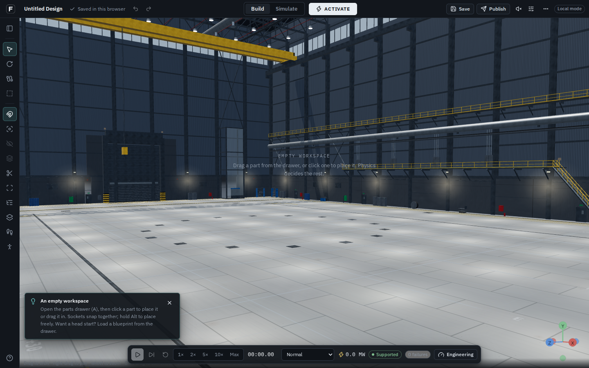
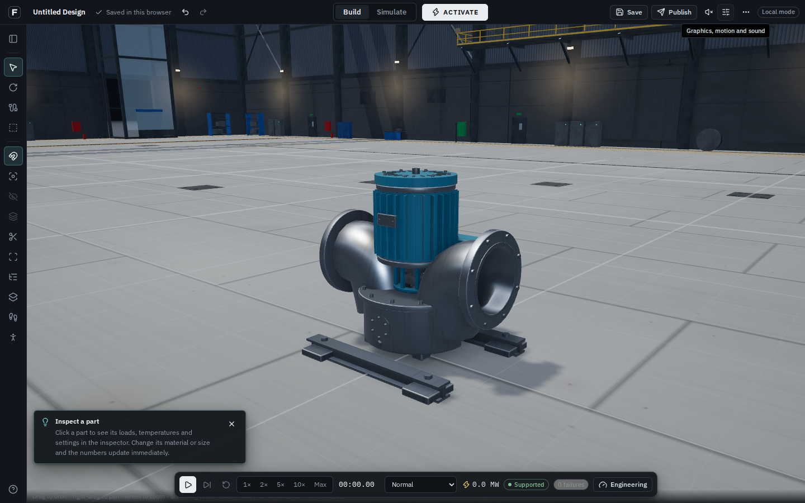
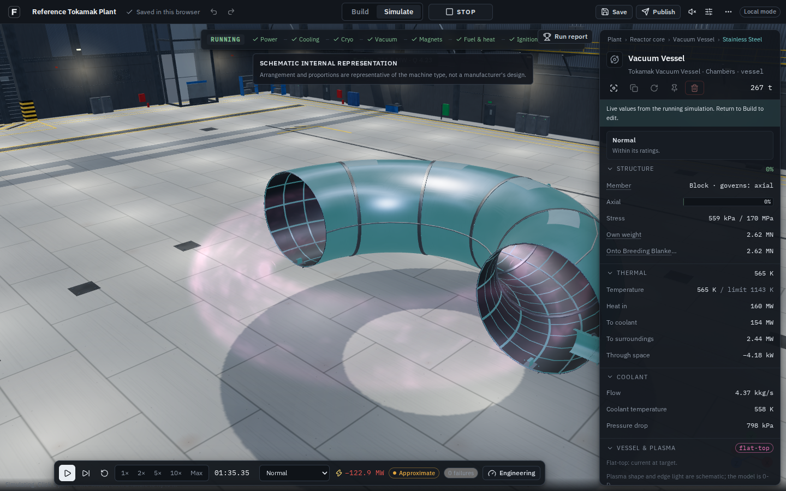

# Visual refinement after the first realism pass

This follow-up addresses the dark machinery, repetitive floor and surface-like plasma
visible in the first pass. It continues `feature/visual-realism`; it does not replace the
builder, introduce a new simulation, or claim photorealism.

## Changes

- **Floor:** 24 m texture repeat instead of 12 m, 6 × 3 m presentation panels, lower
  panel-to-panel contrast and subdued seams. Countersunk fixing radii are specified in
  metres (16 mm), replacing oversized five-texel dots. Dust, scratches and rust are quieter.
  The measured build grid remains available with reduced visual weight. Texture resolution
  stays at 1024²; no new texture or asset downloads are needed.
- **Light:** brighter hemisphere/fill and broad wall/floor bounce in the generated hall
  reflection map. Individual lamp highlights are reduced while the existing roof strips
  provide broader highlights. Roof and dark steel remain readable. The separate after-hours
  light preset is unchanged; shared floor/steel finishes also apply there.
- **Machinery:** rougher machined trim reduces concentrated chrome-like reflections.
  Existing shape, paint, material colours and manufacturing detail are retained.
- **Plasma:** the existing torus/cylinder envelope now contains a bounded optical-volume
  approximation instead of emitting from its polygon surface. Up to 24 samples accumulate
  a soft internal edge, weak interior and moving filaments. Each connected ray interval
  contributes once; a camera inside the volume uses its exit face. The display mapping
  bounds additive brightness to avoid a white ring over a bright background. The shader
  derives its axis and dimensions from the same geometry used by the presentation mesh.
  No positive finite density/active phase means no light; disruption/reset clears the flash.
- **Install:** explicit pnpm dependency build choices allow the existing esbuild installer
  and skip core-js's optional postinstall message. Dependencies and lockfile are unchanged.

## Limits

The plasma remains schematic. Its radial profile, visible emission and bounded integration
length are illustrative; they are not measured emissivity, MHD, spectroscopy, radiative
transfer or a calibrated camera exposure. The 0-D simulation is unchanged. Geometry remains
circular/linear, not an invented D-shaped plasma boundary. The shader uses the existing
mesh/depth testing and does not introduce a separate transparent-volume renderer.

This is a visual refinement, not complete manufacturing art for the entire catalogue. Mesh
collision/navigation, directional grain and welds, authored machine detail, optical glass,
depth-softened smoke and hardware GPU profiling remain work described in
[the original production plan](VISUAL_REALISM_REPORT.md). No sounds or new failure rules
were added. Existing effects still follow actual simulation events.

## Verification

- `pnpm verify`: TypeScript, ESLint, **687 tests in 78 files**, production build passed.
- Two additional plasma tests cover all symmetry axes and linear-vessel dimensions, while
  preserving the existing active/density/reset tests.
- `pnpm vercel-build`: passed in local-only mode; existing large-bundle warnings remain.
- `e2e/visual-realism.mjs`: production Chromium using SwiftShader; see the committed
  [evidence record](visual-refinement/evidence.json). It checks the empty hall, pump quality
  changes, actual flat-top plasma, Stop, electrical sparks, coolant spray, quench mist and
  the eight shader variants in direct/postprocessed rendering. Design hashes must remain
  unchanged across quality changes and resets.
- Hosted account/cloud-save/collaboration/voice acceptance is not verified in this checkout:
  Supabase and LiveKit are not configured. A software renderer does not establish hardware
  frame rates, Chromebook performance, or large-plant usability.

## Captures

These are actual browser screenshots from the production build, not generated concepts.
Hall and pump cameras match the earlier report. Plasma shots show a real paused flat-top
state, but simulation times differ between runs; they are not an equal-time physics comparison.

